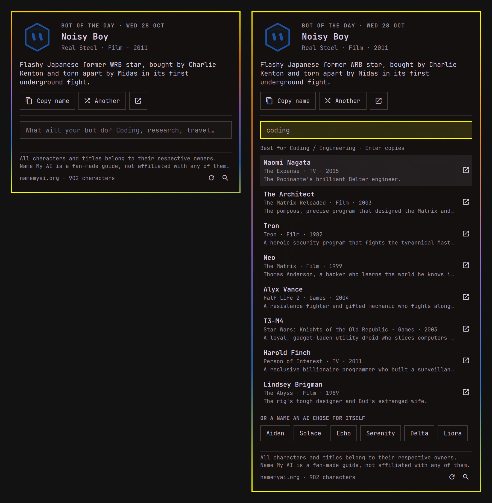

# Omanym

Name your AI from your Omarchy bar.



## Introducing Omanym

Every AI assistant, bot and agent deserves a good name, and the best ones
tend to come from a story. HAL, Jarvis, Data, Marvin: the robots and
computers of film, TV, books and games have been lending their names to our
machines for decades.

Omanym brings those names to your desktop. A small hexagon robot moves into
your bar, glancing about and blinking, and each day it introduces you to one
of the famous robots and AIs collected at [namemyai.org](https://namemyai.org):
the Bot of the Day, the same for everyone that day. Like it? Copy the name in
one click. Not quite right? Shuffle for another, or tell Omanym what your bot
will do and it will suggest names that fit the job.

The name is *oma*, as in Omarchy, plus *eponym*: the person, or here the
robot, that something is named after.

## What it does

- **The bot in the bar**: the namemyai.org mascot in your theme's colours,
  with eyes that wander and blink. Hover it for the Bot of the Day; set the
  **name** style to show the name beside it.
- **Bot of the Day**: who it is, where it's from and a line about it. Copy
  the name, show another, or open it on namemyai.org.
- **Find a name by job**: type what your bot does (coding, research,
  travel, write my emails) and get the eight best fits from 900 sci-fi
  robots, AIs and heroes, scored exactly as the site's own suggester scores
  them. Under them, names AIs chose for themselves, themed to match.

## Install

```bash
omarchy plugin add https://github.com/leewynne/omanym.git --enable
```

The widget lands in the right section of the bar. Move it with
`omarchy bar move leewynne.omanym --section center` or by dragging it.

Requires an Omarchy release with the plugin shell (`omarchy plugin`), and
`curl`, `jq` and `wl-copy`, which Omarchy ships.

## Use

| Action | Does |
|---|---|
| Left click | Open the popup |
| Middle click | Copy the Bot of the Day's name |
| Right click | Open the Bot of the Day on namemyai.org |

Inside the popup: `c` or `Enter` copies the name, `a` or `→` shows another
bot, `t` or `←` goes back to today's, `o` opens it on namemyai.org, `/`
jumps to the job search, `r` checks namemyai.org for new names, `Esc` closes,
and `Tab` moves to the neighbouring bar panel.

In the job search, `↑` `↓` pick a suggestion, `Enter` copies it, `Ctrl+Enter`
opens it on namemyai.org, and `Esc` clears the search. Click a suggestion to
copy it, or right-click it to open it.

It can also be driven over IPC, for a keybinding for instance:

```bash
omarchy-shell shell toggle leewynne.omanym '{}'
omarchy-shell leewynne.omanym copy
omarchy-shell leewynne.omanym another
omarchy-shell leewynne.omanym search "customer support"
omarchy-shell leewynne.omanym refresh
```

## Settings

Change these from the bar settings, or with `omarchy bar set`:

```bash
omarchy bar set leewynne.omanym label name
omarchy bar set leewynne.omanym animate false --json
```

| Key | Values | Default |
|---|---|---|
| `label` | `icon` (the bot alone) or `name` (the bot with the Bot of the Day's name) | `icon` |
| `animate` | `true`, or `false` to keep the bot still | `true` |

## Data

Everything comes from namemyai.org's own data files: its characters,
sources, jobs and self-chosen names. Omanym keeps a copy in
`~/.cache/omanym` so it works offline and opens instantly. Every six hours,
and when you press `r`, it fetches the site's home page to see whether the
site has changed, and downloads the data again only when it has. It sends
nothing else, and no account or API key is needed.

The Bot of the Day is picked from the site's AI characters by the date
where you are, so it changes at your midnight and everyone gets the same bot
on the same day.

All characters and titles belong to their respective owners. Name My AI is
a fan-made guide, not affiliated with or endorsed by any of them.

## Remove

```bash
omarchy plugin remove leewynne.omanym
rm -rf ~/.cache/omanym
```

The first removes the plugin folder and its bar entry; the second its copy of
namemyai.org's data.

## Develop

```bash
./tests/run
```

The model (`Model.js`) is plain JavaScript shared by the QML and the node
tests, and its suggester is a port of the one in namemyai.org's `app.js`.
`tests/fixtures/site-suggestions.json` is what the site suggested for a
dozen jobs, and `site.json` is a trimmed copy of the site's data holding
every character in those lists, so the tests fail if the port ranks
anything differently. `sync.sh` is tested against a stand-in for the site.

## License

MIT
